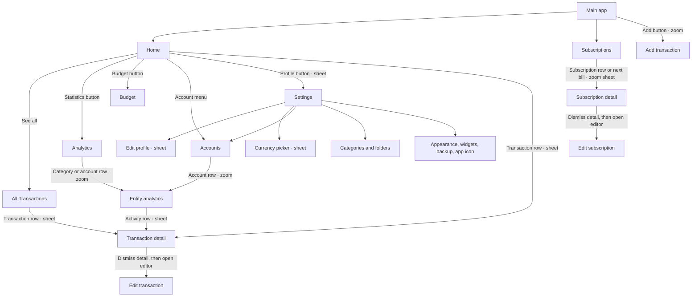

# Spendy navigation

The primary destinations are Home and Subscriptions. Add opens the transaction
editor. Home owns a navigation stack; Settings is a modal with its own stack.
Analytics is reached through Home's statistics button (and app shortcuts).

## Transition rules

- Entity rows zoom into their destination with SwiftUI's native navigation
  transition. Sheets retain their existing detents and explicit close controls.
- Transaction details use the standard bottom-slide sheet presentation.
- Each presenting screen owns its transition namespace. IDs distinguish entity
  types, subscription rows, and next-bill shortcuts.
- A subscription shown in both the list and next-bill area uses the source that
  was tapped. Insights and deep links use the system transition.
- Edit flows dismiss details before opening an editor, using `onDismiss` rather
  than delays. Editors are not anchored to a detail view that has disappeared.
- Reduce Motion disables the added zoom transitions and shared toolbar morphs.
- Inactive tabs are hidden from accessibility navigation.
- All Transactions has an explicit Back control. The Home dock is hidden while
  Home's navigation stack shows a child screen.
- The Home drawer handle toggles expansion; drags move the drawer. Header
  controls, including See all and Clear, receive normal taps. Horizontal filter
  scrolling is outside the drawer header's vertical drag gesture.

## Current limits

- `AppRoute` is a declared route model, but current screens use item/boolean
  navigation bindings. Introducing a central router is a separate change.
- Analytics contains older sections, including a budget card, that are not in
  its current body. Their routes should not be counted as visible features.
- Existing category/account wrappers share `SharedEntityAnalyticsSheet`; these
  are one implementation with different entity inputs.

Reference: [Apple's navigation transition API](https://developer.apple.com/documentation/swiftui/view/navigationtransition(_:)).
